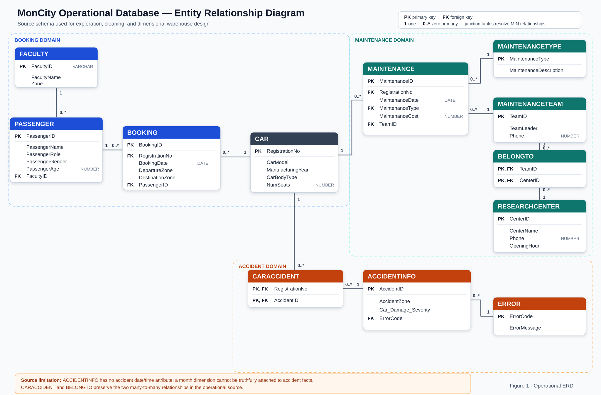
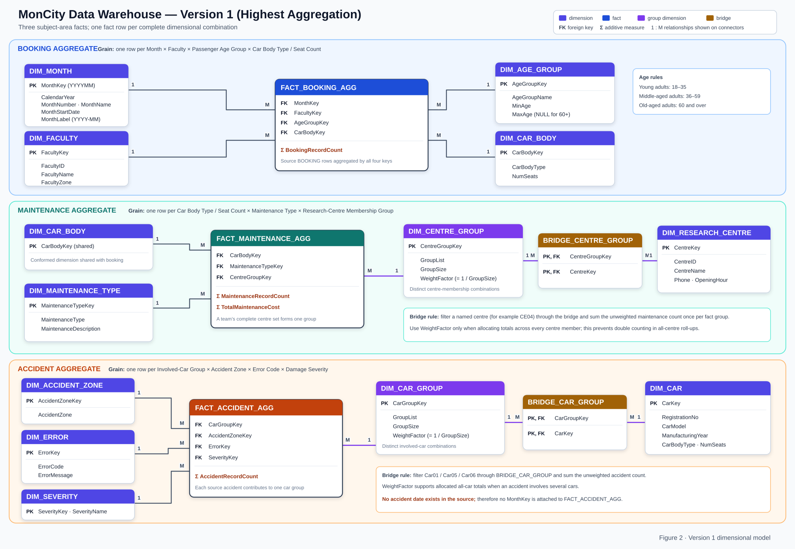
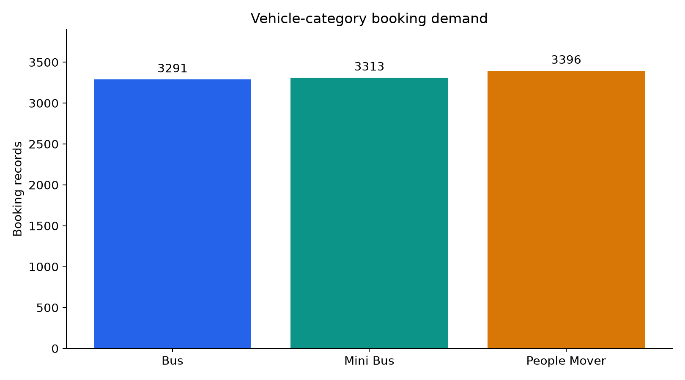
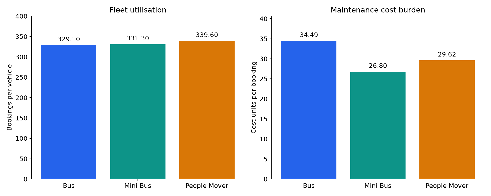
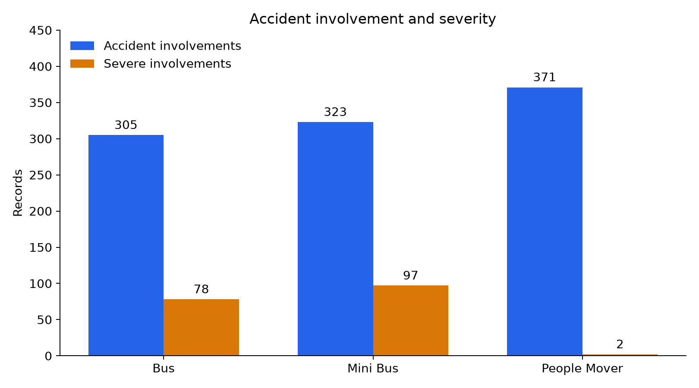

# MonCity Data Warehouse

An Oracle SQL data-engineering case study for a simulated autonomous-vehicle fleet. The project turns booking, maintenance and accident records into a dimensional warehouse and category-level decision-support summaries.

## What this project demonstrates

- Source profiling, relationship checks and an immutable-source staging design.
- Auditable repair actions for a duplicate booking, a missing accident identifier, missing vehicle relationships, a negative maintenance value and an unmapped error code.
- Aggregated booking, maintenance and accident facts, with shared dimensions and bridges for multi-valued memberships.
- Reconciliation checks for record counts, maintenance cost, fact grain and bridge weights.
- Business-facing comparisons of fleet utilisation, maintenance cost and accident severity.

## Architecture




The implementation is the aggregated Oracle warehouse. A separate [transaction-level design](assets/transaction-level-design.svg) documents an alternative level of detail; it is a design artifact, not a claim that a second transaction-level database was deployed.

## Results snapshot

The cleaned snapshot contains 10,000 bookings, 1,001 maintenance records, 994 accident events and 302,900 maintenance-cost units.





People Movers record 339.6 bookings per vehicle, compared with 331.3 for Mini Buses and 329.1 for Buses. Mini Buses have the lowest maintenance cost per booking (26.80 cost units); Buses have the highest (34.49). People Movers have 371 accident involvements, including two severe involvements.

These are descriptive comparisons, not evidence of causation, vehicle reliability or responsibility. Accident dates are unavailable, so accident-to-booking comparisons are not time-aligned rates. One accident can involve multiple vehicles; category involvements are not additive event totals.

## Repository guide

- `sql/`: profiling, staging, warehouse creation, validation and analytical queries.
- `assets/`: editable SVG models and plots generated from the summary export.
- `data/vehicle_category_summary.csv`: aggregate values used by the plots, not passenger-level records.
- `scripts/plot_results.py`: regenerates the presentation plots without an account-specific BI interface.

## Reproduction

For database reproduction, supply an Oracle source schema named `MONCITY` with the entities and columns shown in the operational model. Source transaction data and credentials are not bundled. Use a separate target schema; do not run against a production database.

Run inventory/quality scripts first, then `04_clean_staging.sql`, `05_validate_staging.sql`, `10_create_warehouse.sql`, and the validation scripts. Outputs use the neutral `MC_` prefix. Creation scripts expect a clean target schema. Review every SQL script before execution.

To reproduce the three presentation plots from the included aggregate CSV:

```sh
python -m pip install -r requirements.txt
python scripts/plot_results.py
```

The saved results describe the original snapshot. SQL is supplied for inspection and adaptation; a fresh Oracle execution was not performed during preparation of this repository.
